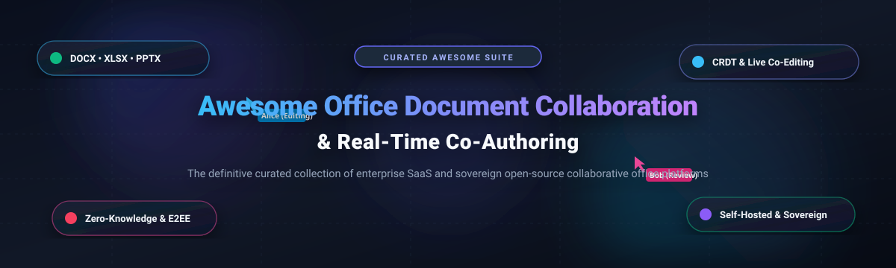

# 📝 Awesome Office Document Collaboration & Co-Authoring 🚀

> ⚡ **A curated directory of top-tier Office Document Collaboration and Real-Time Co-Authoring platforms.** Explore enterprise SaaS suites, sovereign self-hosted software, zero-knowledge encrypted workspaces, and CRDT engines across Word (DOCX), Excel (XLSX), PowerPoint (PPTX), and Markdown ecosystems.

  
  
  
  
  
  

🌟 **Star this repository if you find it helpful!** 🌟

---

## 📑 Table of Contents

- [🌐 Sector Overview & Market Dynamics](#-sector-overview--market-dynamics)
- [🏢 SaaS & Hosted Commercial Platforms](#-saas--hosted-commercial-platforms)
  - [Google Workspace](#-google-workspace)
  - [Microsoft 365](#-microsoft-365)
  - [Quip (Salesforce)](#-quip-salesforce)
  - [Zoho WorkDrive](#-zoho-workdrive)
  - [Dropbox Paper](#-dropbox-paper)
  - [Box Notes](#-box-notes)
- [💻 Open-Source & Self-Hosted Software](#-open-source--self-hosted-software)
  - [AppFlowy](#-appflowy)
  - [AFFiNE](#-affine)
  - [Outline](#-outline)
  - [Univer](#-univer)
  - [Etherpad](#-etherpad)
  - [Overleaf Community Edition](#-overleaf-community-edition)
  - [La Suite Docs](#-la-suite-docs)
  - [Luckysheet](#-luckysheet)
  - [CryptPad](#-cryptpad)
  - [HedgeDoc](#-hedgedoc)
  - [ONLYOFFICE Docs](#-onlyoffice-docs)
  - [Collabora Online](#-collabora-online)
  - [Ethercalc](#-ethercalc)
  - [Documize](#-documize)
  - [Nextcloud Write / Office](#-nextcloud-write--office)
  - [TypstPad](#-typstpad)
  - [Diwan](#-diwan)
- [📊 Feature Comparison Matrix](#-feature-comparison-matrix)
- [📈 Star History](#-star-history)
- [💖 Support & Sponsorship](#-support--sponsorship)
- [🤝 Contributing](#-contributing)
- [📄 License](#-license)

---

## 🌐 Sector Overview & Market Dynamics

The global office productivity and document collaboration software market was valued between **$71B and $78B in 2024**, projected to surpass **$104B to $116B by 2026** at an accelerating **CAGR of ~8%–14%** propelled by generative AI copilot integrations and cloud-native workflows. The industry operates with a **highly concentrated, winner-take-most dynamic** at the top layer—where hyper-scalers **Microsoft (365)** and **Google (Workspace)** command over 80% combined global market share—while fostering an active, moderately fragmented periphery of sovereign, privacy-first, and extensible open-source alternatives (such as Nextcloud, ONLYOFFICE, AppFlowy, and CryptPad) catering to data-residency, air-gapped compliance, and developer customization needs.

---

## 🏢 SaaS & Hosted Commercial Platforms

Commercial, cloud-hosted office document collaboration and co-authoring suites. Sorted in **descending order by company valuation / market capitalization**.

| Rank | Platform | Parent Company | Company Valuation / Revenue | Starting Tier Pricing | Free Tier Limit / Trial Duration | Key Strengths |
|:---:|---|---|---|---|---|---|
| **1** | **[Google Workspace](https://workspace.google.com/)** | Alphabet Inc. (Google) | **~$2.32T – $3.78T Market Cap** *(Revenue: $350.0B)* | **$6.00 / user / month** (Business Starter, annual commitment) | **14-day free trial** (Full Business Starter features up to 10 users); standalone personal Google Docs/Drive accounts have **15 GB free storage forever** | Gold standard in real-time co-authoring, live cursor presence, zero-friction browser sharing, and native Gemini AI integration. |
| **2** | **[Microsoft 365](https://www.microsoft.com/microsoft-365)** | Microsoft Corporation | **~$3.13T – $3.59T Market Cap** *(Revenue: $245.1B)* | **$6.00 / user / month** (Business Basic, annual commitment) | **30-day free trial** (Business Standard for up to 25 users); personal Microsoft accounts receive **5 GB free cloud storage forever** with free Office for the Web access | Unmatched native fidelity for `.docx`, `.xlsx`, and `.pptx`, deep SharePoint governance, desktop app parity, and Copilot. |
| **3** | **[Quip](https://quip.com/)** | Salesforce, Inc. | **~$248B – $320B Market Cap** *(Revenue: $34.9B)* | **$10.00 / user / month** (Quip Starter, billed annually) | **30-day free trial** (Full functionality for up to 250 users); no standalone free tier (requires paid tier or Salesforce seat) | Live embedded spreadsheets and rich documents tightly interconnected with Salesforce CRM objects and chat streams. |
| **4** | **[Zoho WorkDrive & Docs](https://www.zoho.com/workdrive/)** | Zoho Corporation | **~$12.4B Implied Valuation** *(Revenue: $1.25B – $1.50B)* | **$2.50 / user / month** (Starter plan, billed annually; min. 3 users) | **Free Forever Plan** for 1 user with **5 GB storage** and 1 GB file upload limit; **15-day free trial** for Business team tiers | Generous pricing, integrated Writer/Sheet/Show editors, privacy-first commitment, and deep integration with the Zoho ecosystem. |
| **5** | **[Dropbox Paper](https://www.dropbox.com/paper)** | Dropbox, Inc. | **~$7.2B – $9.3B Market Cap** *(Revenue: $2.5B)* | **$9.99 / month** (Dropbox Plus, billed annually; individual) | **Free Forever Plan** (Paper is completely free with standard Dropbox Basic account, limited to **2 GB total account storage**); paid plans offer a **30-day free trial** | Clean, distraction-free markdown-friendly co-editing with media rich previews and seamless sync to Dropbox cloud storage. |
| **6** | **[Box Notes](https://www.box.com/notes)** | Box, Inc. | **~$4.5B – $5.8B Market Cap** *(Revenue: $1.04B – $1.09B)* | **$15.00 / user / month** (Business Starter, billed annually; min. 3 users) | **Free Forever Individual Plan** with **10 GB cloud storage** (250 MB max file upload limit); **14-day free trial** for Business tiers | Enterprise-grade security and access controls for collaborative note taking, audit trails, and automated team workflows. |

---

### 🔍 Deep Dive into SaaS Solutions

#### 🔹 Google Workspace
- **Core Products:** Docs, Sheets, Slides, Drive, Meet
- **Ecosystem:** Alphabet / Google Cloud
- **Description:** Google Workspace pioneered browser-based document collaboration. With real-time multiplayer editing, smart canvas chips, suggested edits, and embedded Gemini AI, it remains the standard benchmark for distributed teams and frictionless co-authoring.

#### 🔹 Microsoft 365
- **Core Products:** Word, Excel, PowerPoint, OneNote, OneDrive, Teams
- **Ecosystem:** Microsoft Cloud / Azure
- **Description:** Microsoft 365 provides Word, Excel, and PowerPoint with real-time co-authoring, comments, and track changes across web, desktop, and mobile. It is the indispensable choice for enterprises requiring complex spreadsheet macros, strict regulatory compliance, and native Office file fidelity.

#### 🔹 Quip (Salesforce)
- **Core Products:** Quip Docs, Spreadsheets, Slides, Live Apps
- **Ecosystem:** Salesforce Customer 360
- **Description:** Acquired by Salesforce, Quip merges live document composition directly into enterprise CRM records. Team members can manipulate interactive spreadsheets and project plans inline without switching tabs or context.

#### 🔹 Zoho WorkDrive & Docs
- **Core Products:** Zoho Writer, Zoho Sheet, Zoho Show, WorkDrive
- **Ecosystem:** Zoho One Suite
- **Description:** Zoho delivers a comprehensive cloud office suite featuring powerful word processing, collaborative spreadsheets, and slide deck generation at aggressive price points, backed by an unyielding privacy policy that avoids behavioral advertising.

#### 🔹 Dropbox Paper
- **Core Products:** Paper Docs, Dropbox Replay, Cloud Sync
- **Ecosystem:** Dropbox Cloud
- **Description:** Dropbox Paper delivers an ultra-clean, minimalist writing environment optimized for agile project briefs, meeting notes, checklist delegation, and embedded multimedia embeds.

#### 🔹 Box Notes
- **Core Products:** Box Notes, Box Canvas, Box Content Cloud
- **Ecosystem:** Box Enterprise Content Management
- **Description:** Box Notes provides concurrent collaborative document and meeting agenda creation protected under Box's enterprise-grade encryption, HIPAA/FedRAMP compliance standards, and automated retention policies.

---

## 💻 Open-Source & Self-Hosted Software

Self-hosted, community-driven, and sovereign office collaboration solutions. Listed in **descending order by GitHub Stars_Count** with real-time social badges linking directly to their stargazer pages.

| Software | GitHub_Stars | Tech Stack | License | Core Focus & Format Compatibility |
|---|:---:|---|---|---|
| **[AppFlowy](#-appflowy)** |  | Flutter / Rust | AGPL-3.0 | Sovereign, offline-first Notion & Google Docs alternative with board, grid, and document views. |
| **[AFFiNE](#-affine)** |  | TypeScript / Rust | MIT | Next-gen collaborative knowledge base unifying canvas whiteboards, docs, and tables in one workspace. |
| **[Outline](#-outline)** |  | TypeScript / Node.js / React | BSL 1.1 | Fast, team knowledge base and real-time collaborative markdown document wiki with structured hierarchy. |
| **[Univer](#-univer)** |  | TypeScript / Canvas | Apache-2.0 | Full-stack office engine combining collaborative spreadsheets, documents, and slides with canvas rendering. |
| **[Etherpad](#-etherpad)** |  | JavaScript / Node.js | Apache-2.0 | Pioneer of multiplayer rich-text co-editing with author color coding and character-by-character timeslider playback. |
| **[Overleaf CE](#-overleaf-community-edition)** |  | Node.js / Docker / LaTeX | AGPL-3.0 | Real-time collaborative cloud LaTeX and scientific documentation engine with live compiled PDF preview. |
| **[La Suite Docs](#-la-suite-docs)** |  | Django / React / ProseMirror | MIT | European sovereign cloud editor backed by French DINUM & German ZenDiS for collaborative document editing. |
| **[Luckysheet](#-luckysheet)** |  | JavaScript / Canvas | MIT | Pure frontend collaborative online spreadsheet library with Excel formula support, pivot tables, and charts. |
| **[CryptPad](#-cryptpad)** |  | JavaScript | AGPL-3.0 | Privacy-first office suite with client-side zero-knowledge end-to-end encryption for rich text, sheets, and slides. |
| **[HedgeDoc](#-hedgedoc)** |  | Node.js / React | AGPL-3.0 | Collaborative markdown platform (formerly CodiMD) with live dual-pane rendering, YAML metadata, and slide mode. |
| **[ONLYOFFICE Docs](#-onlyoffice-docs)** |  | C++ / JS / Node.js | AGPL-3.0 | Gold standard in open-source MS Office format compatibility (`.docx`, `.xlsx`, `.pptx`) with paragraph locking. |
| **[Collabora Online](#-collabora-online)** |  | C++ / LibreOffice Core | MPL-2.0 | Enterprise LibreOffice in the cloud with OpenDocument standard fidelity and seamless Nextcloud integration. |
| **[Ethercalc](#-ethercalc)** |  | LiveScript / Node.js | CPAL-1.0 | Collaborative online spreadsheet server with real-time cell updates, formula evaluation, and REST API. |
| **[Documize](#-documize)** |  | Go / Vue.js | AGPL-3.0 | Modern knowledge management and documentation workspace organizing snippets, Word documents, and wikis. |
| **[Nextcloud Write](#-nextcloud-write--office)** |  | PHP / Vue / Collabora | AGPL-3.0 | Fully integrated sovereign office collaboration suite featuring federated editing and local AI assistants. |
| **[TypstPad](#-typstpad)** |  | Go / Typst / Yjs | MIT | Collaborative real-time Typst typesetting editor with WASM live preview, comments, and AI MCP agent server. |
| **[Diwan](#-diwan)** |  | Go / CRDT (Yjs) | MIT | Single-binary self-hostable office suite with embedded frontend, peer-to-peer encrypted rooms, and local storage. |

---

### 🛠️ Open-Source Project Summaries

#### 📦 [AppFlowy](https://github.com/AppFlowy-IO/AppFlowy)

- **Stack:** Flutter / Rust / SQLite | **License:** AGPL-3.0
- **Summary:** AppFlowy is an open-source, local-first alternative to Notion that puts you in complete control of your data and customizations. It provides rich document authoring, kanban boards, calendar scheduling, and granular offline data synchronization.
- **Best For:** Teams seeking local-first data privacy and flexible modular workspaces without cloud vendor lock-in.

#### 📦 [AFFiNE](https://github.com/toeverything/AFFiNE)

- **Stack:** TypeScript / Rust / CRDT | **License:** MIT
- **Summary:** AFFiNE is a next-generation workspace combining documents, whiteboards, and structured databases into one canvas. Unlike traditional doc suites, any paragraph can instantly transform into an infinite canvas node for visual brainstorming.
- **Best For:** Creative and visual thinkers needing unified whiteboard mindmapping and structured document writing.

#### 📦 [Outline](https://github.com/outline/outline)

- **Stack:** Node.js / React / PostgreSQL | **License:** BSL 1.1
- **Summary:** Outline is a fast, beautifully designed knowledge base and documentation platform built for growing teams. Features markdown shortcuts, instant search, enterprise SSO, permission controls, and real-time multiplayer editing.
- **Best For:** Engineering and product teams wanting a blazing fast team wiki and modern internal documentation hub.

#### 📦 [Univer](https://github.com/dream-num/univer)

- **Stack:** TypeScript / Canvas2D / WebGL | **License:** Apache-2.0
- **Summary:** Univer is an enterprise-grade collaborative office core framework designed to render spreadsheets, rich-text documents, and slide presentations directly in the browser with high-performance canvas acceleration.
- **Best For:** Developers embedding collaborative spreadsheet, doc, and slide capabilities natively into SaaS products.

#### 📦 [Etherpad](https://github.com/ether/etherpad-lite)

- **Stack:** JavaScript / Node.js | **License:** Apache-2.0
- **Summary:** Etherpad is a battle-tested, highly customizable real-time collaborative text editor. Provides distinct authorship colors for concurrent editors, a signature interactive time-slider history scrubber, and hundreds of community plugins.
- **Best For:** Fast, lightweight concurrent note taking, education setups, and hackathon scratchpads.

#### 📦 [Overleaf Community Edition](https://github.com/overleaf/overleaf)

- **Stack:** Node.js / Docker / TeX Live | **License:** AGPL-3.0
- **Summary:** Overleaf Community Edition is the self-hostable version of the premier collaborative cloud LaTeX editor. It empowers academic researchers and technical writers to co-author scientific papers with instant compilation and bibliography management.
- **Best For:** Universities, researchers, and scientific engineers drafting math-heavy LaTeX publications.

#### 📦 [La Suite Docs](https://github.com/suitenumerique/docs)

- **Stack:** Django / React / ProseMirror / Yjs | **License:** MIT
- **Summary:** Spearheaded by the French Interministerial Digital Directorate (DINUM) and supported by Germany's ZenDiS, La Suite Docs is a sovereign European collaborative document editor providing block-based formatting, slash commands, and team spaces.
- **Best For:** Public administrations and sovereign European organizations demanding zero foreign cloud exposure.

#### 📦 [Luckysheet](https://github.com/dream-num/Luckysheet)

- **Stack:** JavaScript / HTML5 Canvas | **License:** MIT
- **Summary:** Luckysheet is an online spreadsheet library that recreates the full desktop Excel experience on the web. It supports cell formatting, formulas, pivot tables, data verification, conditional formatting, and multi-user cell synchronization.
- **Best For:** Web applications needing an embedded, Excel-compatible interactive spreadsheet interface.

#### 📦 [CryptPad](https://github.com/cryptpad/cryptpad)

- **Stack:** JavaScript / WebCrypto | **License:** AGPL-3.0
- **Summary:** CryptPad delivers a full zero-knowledge collaboration suite spanning rich-text docs, code pads, kanban boards, spreadsheets, and presentations. Data is encrypted and decrypted strictly in the browser using client-side cryptographic keys.
- **Best For:** Investigative journalists, human rights organizations, and privacy-conscious enterprises.

#### 📦 [HedgeDoc](https://github.com/hedgedoc/hedgedoc)

- **Stack:** Node.js / React / CodeMirror | **License:** AGPL-3.0
- **Summary:** HedgeDoc (formerly CodiMD) provides self-hosted real-time collaborative markdown writing. Includes MathJax math notation, Mermaid and PlantUML diagrams, embedded slide mode, and instant permission toggles.
- **Best For:** Developers and technical squads writing collaborative technical specs and architectural plans.

#### 📦 [ONLYOFFICE Docs](https://github.com/ONLYOFFICE/DocumentServer)

- **Stack:** C++ / JavaScript / Node.js | **License:** AGPL-3.0
- **Summary:** The premier open-source document server for Microsoft Office compatibility. Delivers pixel-accurate formatting for DOCX, XLSX, and PPTX with paragraph-locking co-editing, macro execution, and deep integration with Nextcloud and ownCloud.
- **Best For:** Enterprises demanding seamless MS Office file format fidelity in a self-hosted cloud environment.

#### 📦 [Collabora Online](https://github.com/CollaboraOnline/online)

- **Stack:** C++ / LibreOffice Core | **License:** MPL-2.0
- **Summary:** Collabora Online brings the full engine of LibreOffice directly into the web browser. Prioritizes open document standards (ODT, ODS, ODP) with full DOCX/XLSX support, making it the flagship document editor for sovereign data clouds.
- **Best For:** Organizations committed to open document standards (ODF) and sovereign infrastructure.

#### 📦 [Ethercalc](https://github.com/audreyt/ethercalc)

- **Stack:** LiveScript / Node.js | **License:** CPAL-1.0
- **Summary:** Ethercalc is an independent, multiplayer collaborative web spreadsheet server. Simultaneous edits to any cell update in real-time across all browser windows, complete with formula computations and JSON REST endpoints.
- **Best For:** Lightweight collaborative budgeting, tabular data entry, and developer automation scripts.

#### 📦 [Documize](https://github.com/documize/community)

- **Stack:** Go / Vue.js | **License:** AGPL-3.0
- **Summary:** Documize organizes technical and business knowledge by composing rich documents from modular snippets, code samples, Word documents, and markdown blocks into an organized portal.
- **Best For:** Internal technical documentation and policy management.

#### 📦 [Nextcloud Write / Office](https://github.com/nextcloud/richdocuments)

- **Stack:** PHP / Vue.js / Collabora Core | **License:** AGPL-3.0
- **Summary:** Built directly into the Nextcloud content ecosystem, Nextcloud Office enables federated co-authoring between distinct Nextcloud servers, track changes, version rollbacks, and local AI writing assistance.
- **Best For:** Full sovereign enterprise cloud deployments with files, chat, and collaborative documents under one roof.

#### 📦 [TypstPad](https://github.com/ladderlogix/typstpad)

- **Stack:** Go / Typst / Yjs | **License:** MIT
- **Summary:** TypstPad is a self-hosted collaborative editor for the modern Typst typesetting system. Features WebAssembly live previews, SSO authentication, tracked suggestions, and a native Model Context Protocol (MCP) server for AI agents.
- **Best For:** Scientists, researchers, and engineers drafting modern formatted publications with AI copilot integration.

#### 📦 [Diwan](https://github.com/vul-os/diwan)

- **Stack:** Go / CRDT (Yjs) | **License:** MIT
- **Summary:** Delivered as a single standalone executable Go binary with an embedded frontend, Diwan provides real-time co-authoring for docs, spreadsheets, slides, and whiteboards via end-to-end encrypted rooms.
- **Best For:** Minimalist deployments and privacy enthusiasts seeking zero configuration overhead.

---

## 📊 Feature Comparison Matrix

| Software Platform | Type | Primary File Formats | Real-Time Cursors | Offline Support | End-to-End Encryption | Self-Hosted Option |
|---|:---:|---|:---:|:---:|:---:|:---:|
| **Google Workspace** | SaaS | DOCX, XLSX, PPTX, Google Formats | ✅ Yes | ✅ Chrome Extension | ❌ (Server Encrypted) | ❌ Cloud Only |
| **Microsoft 365** | SaaS | DOCX, XLSX, PPTX, ODF | ✅ Yes | ✅ Desktop Client | ❌ (Enterprise Keys) | ❌ Cloud Only |
| **Quip** | SaaS | Quip Docs, Spreadsheets | ✅ Yes | ✅ Desktop/Mobile | ❌ | ❌ Cloud Only |
| **Zoho WorkDrive** | SaaS | DOCX, XLSX, PPTX, Zoho Docs | ✅ Yes | ✅ Sync Client | ❌ | ❌ Cloud Only |
| **Dropbox Paper** | SaaS | Paper, Markdown, Rich Text | ✅ Yes | ✅ Mobile Apps | ❌ | ❌ Cloud Only |
| **Box Notes** | SaaS | Box Notes, Rich Text | ✅ Yes | ✅ Sync Client | ❌ | ❌ Cloud Only |
| **AppFlowy** | Open-Source | Markdown, JSON, SQLite | ✅ Yes | ✅ Native Local-First | ⚠️ User Managed | ✅ Yes |
| **AFFiNE** | Open-Source | Markdown, HTML, Canvas State | ✅ Yes | ✅ Native Local-First | ⚠️ User Managed | ✅ Yes |
| **Outline** | Open-Source | Markdown, HTML, JSON | ✅ Yes | ❌ Limited | ❌ | ✅ Yes |
| **Univer** | Open-Source | XLSX, DOCX, Canvas Core | ✅ Yes | ⚠️ Configurable | ❌ | ✅ Yes |
| **Etherpad** | Open-Source | Plain Text, HTML, Etherpad Pad | ✅ Yes | ❌ Server Required | ❌ | ✅ Yes |
| **Overleaf CE** | Open-Source | LaTeX, TeX, PDF | ✅ Yes | ❌ Server Required | ❌ | ✅ Yes |
| **La Suite Docs** | Open-Source | ProseMirror, Markdown, DOCX | ✅ Yes | ❌ Server Required | ❌ | ✅ Yes |
| **Luckysheet** | Open-Source | XLSX, JSON, Tabular Data | ✅ Yes | ⚠️ In-Browser | ❌ | ✅ Yes |
| **CryptPad** | Open-Source | Encrypted ODF, Markdown, Sheets | ✅ Yes | ❌ Client Keys | ✅ Full Zero-Knowledge | ✅ Yes |
| **HedgeDoc** | Open-Source | Markdown, HTML | ✅ Yes | ❌ Server Required | ❌ | ✅ Yes |
| **ONLYOFFICE Docs** | Open-Source | Native DOCX, XLSX, PPTX, PDF | ✅ Yes | ✅ Desktop Client | ⚠️ Document Password | ✅ Yes |
| **Collabora Online** | Open-Source | Native ODT, ODS, ODP, DOCX, XLSX | ✅ Yes | ✅ Desktop / App | ❌ | ✅ Yes |
| **TypstPad** | Open-Source | Typst, PDF, PNG | ✅ Yes | ❌ Server Required | ❌ | ✅ Yes |
| **Diwan** | Open-Source | Rich Text, Sheets, Canvas | ✅ Yes | ✅ Local Storage | ✅ P2P Encrypted Rooms | ✅ Yes |

---

## 📈 Star History

---

## 💖 Support & Sponsorship

If this curated repository saved you hours of research or helped you architect your collaboration stack, please consider supporting the project:

- ⭐ **Star this repository** to improve visibility for the open-source community.
- 🍴 **Fork the repo** to keep a copy and contribute your enhancements.
- 📢 **Share with colleagues** across social channels, Discord communities, and developer teams.
- ☕ **Buy me a coffee / Sponsor the author** directly via the [GitHub Sponsors Dashboard](https://github.com/sponsors/ishandutta2007).

Your sponsorship directly funds the continuous tracking, testing, and maintenance of awesome developer resources! 🚀

---

## 🤝 Contributing

Contributions are warmly welcomed! If you develop or discover an open-source office document collaboration or real-time co-authoring tool that should be included:

1. Check that the project is actively maintained (commits or releases within the past 12 months).
2. Ensure it is genuinely open-source with an approved OSI or community license.
3. Submit a Pull Request following our tabular and categorized documentation structure.

Please visit [Awesome Awesome Awesome](https://github.com/ishandutta2007/Awesome-Awesome-Awesome) for more curated lists!

---

## 📄 License

This repository and compilation are distributed under the [Creative Commons Zero v1.0 Universal](LICENSE) (CC0 1.0) Public Domain dedication. The linked software suites and repositories belong to their respective creators under their own licensing terms.
